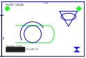

# DWG 预览 · dsh-dwg-preview

[中文](README.md) | [English](README.en.md)

> DeepSeek Harness（DSH）桌面端的文档预览插件：在工作区里点开 `.dwg` / `.dxf` 图纸，
> 右侧预览标签直接显示矢量图形 —— 可拖拽平移、Ctrl/⌘ + 滚轮缩放、一键适应宽度。

DSH 自带的预览只认识文本与图片，DWG 图纸点开只会是「无法预览」。这个插件补上那一步：宿主侧用 LibreDWG（编译成 WebAssembly）把 DWG 解成 DXF，再用本仓库里零依赖的渲染器 `lib/dxf2svg.mjs` 画成一张自包含的 SVG；浏览器侧只负责显示这张图，不解码、不加载任何第三方查看器库。DXF 是纯文本，不需要 LibreDWG，直接进渲染器。



上图由 `test/sample.dxf` 生成（`node tools/make-example.mjs`），覆盖下面列出的图元类型。

## 它做什么

- 位置：工作区文件树里点开 `.dwg` 或 `.dxf`，右侧文档预览标签里的内容就是它 —— 槽位 `sidebar.right.tab.document`，body 键 `@local/dsh-dwg-preview/dwg`。
- 行 id：`dwg-preview`（见 `cordis.patch.yml`）。插件不注册设置页，所以没有 `order`。
- 接管方式：向官方 `sidebar-documentpreview` 插件提供的注册表登记一个渲染器，声明后缀 `dwg` 与 `dxf`、`priority: 'extension'`（按后缀认领）、`loading: 'bytes-complete'`（要整份文件，不是流）。其它后缀不受影响。
- 工具栏：放大、缩小、适应宽度，以及当前图纸的图元总数；视图里可拖拽平移，Ctrl/⌘ + 滚轮缩放，普通滚轮仍然是滚动。
- 宿主侧两条路由（挂在 connection 的共享 `/api` 通道上）：

| 方法 | 路径 | 响应 |
| --- | --- | --- |
| GET | `/api/dwg-preview/ping` | `200 {"ok":true,"plugin":"dsh-dwg-preview","cache":<已缓存张数>}` |
| POST | `/api/dwg-preview/svg` | `200 {"ok":true,"kind":"dwg"\|"dxf","svg":…,"stats":…}` |
| POST | `/api/dwg-preview/svg` | `400 {"ok":false,"code":"EMPTY","message":"文件内容为空"}` |
| POST | `/api/dwg-preview/svg` | `413 {"ok":false,"code":"TOO_LARGE","message":"文件超过 64 MB，预览已跳过"}` |
| POST | `/api/dwg-preview/svg` | `500 {"ok":false,"code":"FAILED","message":…}` |

- 依赖：浏览器半边只 `require('react')`；DWG 解码需要 `@mlightcad/libredwg-web`（见文末许可）。

## 怎么工作

1. 文档预览把文件的原始字节交给这个渲染器（`content.kind === 'bytes'`）。
2. 浏览器半边把字节 `POST` 到 `/api/dwg-preview/svg`，附带 `x-dwg-name`（百分号编码的文件名，只作旁注 —— 宿主的格式判定不看它）。
3. 宿主按**内容**判定格式：前 8 字节以 `AC10xx` 开头是 DWG；前 8 KB 里同时出现 `SECTION` 与 `HEADER`/`ENTITIES` 是 DXF；都不是就报 `FAILED`。
4. DWG 交给 LibreDWG（WASM）转成 DXF；DXF 直接进 `dxfToSvg()`。
5. 渲染结果是一张自包含 SVG（`viewBox` + 背景 `rect` + 一个翻转 `g`），整份字符串返回给浏览器，浏览器用 Blob URL 显示。

为什么要绕这一圈：LibreDWG 的 wasm 约 9.5 MB，而 DWG 解码是 CPU 密集的同步调用。放进宿主进程，页面侧只处理一张图片；放进页面，每个预览标签都要为它付一份代价。DXF 路径是纯函数，所以能完全离线测试。

渲染器覆盖的图元：LINE、LWPOLYLINE（含 bulge 圆弧）、POLYLINE + VERTEX、CIRCLE、ARC、ELLIPSE、TEXT、MTEXT、ATTRIB、INSERT（嵌套块、行列阵列、旋转与缩放）、HATCH（多段线边界与边边界：直线、圆弧、椭圆弧、拟合点）、SOLID / 3DFACE、POINT、DIMENSION（走它的匿名块）。**列表之外的实体被忽略**，不报错也不画。

### 刻意的取舍

- **范围**：优先用图纸自己的 `$EXTMIN` / `$EXTMAX`；缺失或退化时用模型空间坐标的原始跨度。**块内几何不参与范围计算** —— 有些块带着远在图纸之外的垃圾几何，否则会把视图撑坏。最后加 2% 内边距。
- **垃圾几何过滤**：块内实体（嵌套深度 > 0）的世界坐标足迹若超过图纸对角线的 3 倍，或超过 0.8 倍且中心落在「图纸 ± 0.6 倍跨度」的裁剪带之外，则整条丢弃；INSERT 阵列落在这条带外的肢体也不画。丢弃数量记在 `stats.__stray`（图元级）与 `stats.__skippedOutside`（总数，含被丢掉的阵列肢体），界面不显示。
- **图层颜色取绝对值**：libredwg 写出的 DXF 把每个图层颜色都写成负数（DXF 里表示「图层关闭」），所以这里一律忽略符号、只看颜色号。代价是不实现「按颜色关闭图层」，只有 `70` 位 1（冻结）的图层会被跳过。
- **曲线**：bulge 段转成 SVG 的 `A` 命令；ARC 用一段 `A`；HATCH 的圆弧边界按每 10° 一段折线近似（单条最多 64 段），椭圆弧按每 15° 一段。
- **文字**：TEXT / ATTRIB / MTEXT 都放在翻转组里再用 `scale(1 -1)` 翻回来，所以字是正的。MTEXT 只做有限清洗（`\P` 换行、`\A…;` 一类格式码、`{}`、`\~`），**格式与堆叠分数会丢**；不嵌入字体，字形靠系统字体（`SimSun, 'Microsoft YaHei', sans-serif`），换机器字形会变；不做折行与分栏，也不做 SHX 大字体。
- **不画线型与线宽**：全部是实线，靠 `vector-effect="non-scaling-stroke"` 在任何缩放下保持 1 像素。
- **只读**：没有实体拾取、没有图层开关、没有标注编辑、没有打印导出。

顺带说清楚计数口径：预览页上的「N 个图元」是渲染器各类型计数之和；`ATTRIB` 在图元遍历与图元渲染两处各计一次，所以含属性块的图纸会多算一个。它只是显示口径，不影响绘制。

## 安装

本插件是一个标准 DSH bundle：`package.json` 里声明了 `dsh.bundle.patch` 与 `dsh.client`，装进任何 profile 都走同一条路。先装好 DSH 桌面端（[deepseek.com/download](https://www.deepseek.com/download/)），然后下面任选一种。

### 方式一 · 在 DSH 桌面端里装（推荐）

1. 侧栏点 **插件** → **添加插件**（Add plugin）；
2. 在输入框里填下面任意一种 spec：
   - 本仓库地址：`https://github.com/linanbuan/dsh-dwg-preview`
   - 本仓库的压缩包链接（GitHub 页面的 `Source code (zip)`）
   - 已经克隆到本机的**目录绝对路径**
   - 包名（若将来发布到 npm）
3. 点 **安装**：Harness 先读出这个 spec 指向什么（包名、简介、版本），确认后开始装；
4. 装完点 **立即启用**。

整个安装由 Harness 自己的插件管理器完成：把这个包写进当前 profile 的 `dsh.profile.bundles`，并挂上宿主半边。**桌面端装插件不需要命令行，也不需要手改 profile 文件。**

### 方式二 · 让 Agent 自己装

把仓库地址或本机目录直接交给任意会话里的 Agent，它会调用 `plugin_manager` 工具（`action: install_bundle`）走同一条路。这是官方给第三方插件推荐的安装方式。

### 方式三 · 命令行

装了 dsh CLI 的机器上：

```bash
dsh plugin --profile <profile 名> add <spec>
```

`<spec>` 与方式一相同（包名、Git 地址、压缩包链接或本地路径）；参数以 `dsh plugin --help` 的实际输出为准。

### 方式四 · 手工装进某个 profile（排障用，不推荐）

profile 目录默认在 `~/.dsh/profiles/<profile 名>`。把包放进去，并在 profile 自己的 `package.json` 里登记两处：

```json
"dependencies": { "@local/dsh-dwg-preview": "link:<本目录绝对路径>" },
"dsh": { "profile": { "bundles": [ "…", "@local/dsh-dwg-preview" ] } }
```

手改 profile 文件要过权限审批，写坏会让 Harness 起不来，所以正常安装请走前面三种。手工安装时依赖不会自动装：宿主半边需要 `@mlightcad/libredwg-web`，你要自己把它装进 profile（方式一至方式三由 Harness 按 `dependencies` 装）。

## 装上之后

- **浏览器半边**：注册 `documentPreviews` 渲染器与 `sidebar.right.tab.document` 的 body，随启动图加载；由 HMR 更新时不需要刷新页面。
- **宿主半边**：注册两条 `/api/dwg-preview/*` 路由。安装时若提示需要重启，**重启 DeepSeek Harness 应用**（不是刷新页面）—— 桌面 profile 的 base 组合包以 `root: []` 启用 HMR（只监听显式注册的配置），而 HMR 的忽略规则默认含 `**/node_modules`，装在 `node_modules` 下的插件代码不在监听范围内。
- **注册表要先在**：渲染器登记到官方 `@deepseek-ai/dsh-client-ui-sidebar-documentpreview` 插件提供的注册表上（`dsh.client.inject` 声明了这份加载顺序）。注册表还没就绪时，浏览器半边会在 6 秒内每 150 毫秒重试一次（最多 40 次），不会静默丢掉渲染器。
- **第一次看 DWG 会慢一点**：宿主懒加载 LibreDWG 的 wasm（约 9.5 MB）并只建一次实例，之后复用。
- **确认它在跑**：侧栏 **插件** → 找到这个包，看组件状态是否为「运行中」；也可以在会话里请求 `GET /api/dwg-preview/ping`。

### 停用 / 卸载

临时关掉（在 profile 自己的 `cordis.patch.yml` 里，或直接用插件页那一行的开关）：

```yaml
- id: dwg-preview
  disabled: true
```

彻底移除：插件页 → 这个包 → **卸载**，它会把包从 profile 的依赖与 `dsh.profile.bundles` 里去掉。

## 注意事项

1. **本插件不是官方插件**：与 DeepSeek AI 无任何关联，不提供服务承诺。它跟随 Harness 的插件接缝工作，Harness 升级后可能失效；失效时预览以错误码或「预览失败」的形式退化，不会影响 Harness 本身启动。
2. **安装后不会自动更新**：官方插件管理器目前不支持自动更新，升级＝先卸载再装新版。手动替换已安装的包之后，宿主半边要**重启应用**才会加载新代码（Node 的 ESM 缓存按文件 URL 命中，停用再启用只会重跑旧模块的 `apply()`）；浏览器半边在开发时由 HMR 更新。
3. **平台**：只要 DSH 能跑（Windows / macOS / Linux）即可用。DXF 路径是纯 Node 代码；DWG 路径依赖 `@mlightcad/libredwg-web` 的 wasm，同样跨平台。本插件在 **Windows 桌面端 + DSH `0.1.7-rc.2`** 上实测过。
4. **用到的内部接缝不是稳定 API**：`connection.fetch.register`、`slots.register`、`locale.register` 与 `documentPreviews` 注册表都是 Harness 的内部形态，官方没有兼容承诺，版本升级后可能改名或改形。
5. **权限**：只读预览。除了在插件目录追加一行 `.mount.log` 挂载标记（已 gitignore，只为排障），它不写任何文件；不读你的会话、不读凭据、不联网、无遥测。
6. **数据在哪**：文件字节只在**本机宿主进程**里处理 —— 读进内存、解码、渲染，随请求结束释放；渲染结果按 sha1 缓存在内存里（最多 6 张，进程退出即消失）。浏览器半边拿到的只是 SVG 字符串。任何内容都不会上传，也不会写到磁盘。
7. **一起分发要付 GPL-3.0 的代价**：DWG 解码依赖 `@mlightcad/libredwg-web`（GPL-3.0），它由 Harness profile 按 `dependencies` 单独安装，本仓库不分发它。若你把本插件与它打进同一份 bundle 再分发，这份组合受 GPL-3.0 约束；本仓库自己的代码是 MIT。
8. **失败是退化，不是崩溃**：空文件 `400 EMPTY`、超过 64 MB `413 TOO_LARGE`、格式认不出或解码失败 `500 FAILED`，界面显示「预览失败」与原因；路由把异常都收在响应里，不会把宿主进程带崩。
9. **没有破坏性操作**：它不删除、不覆盖、不改名任何文件，也不修改 profile 配置；唯一的写入是那一行挂载标记。卸载就是移除包本身。
10. **64 MB 是请求体上限**：超过就不解码，直接 `TOO_LARGE`。上限以内的大图纸仍会占用宿主进程的内存，并让它同步忙上一会儿（渲染是同步的）。
11. **不支持编辑类功能**：没有实体拾取、图层开关、标注编辑、打印导出。渲染器认不出的实体会被静默忽略，所以「画出来了但少东西」时先对照上面那份图元清单。
12. **隐私**：本仓库不含任何密钥、账号标识或本机路径；示例图纸 `test/sample.dxf` 是为这个仓库手写的，不含任何真实图纸数据。

## 自检

```bash
node test/selfcheck.mjs      # 或 pnpm test
node tools/make-example.mjs  # 重新生成 docs/example.svg（或 pnpm run example）
```

自检不需要网络、不需要 Harness、不需要 React、不需要安装任何依赖，纯 Node 跑完 31 项，全部通过时打印 `31/31 checks passed` 并以 0 退出，任何一项失败就以非 0 退出（可直接接 CI）。注意 `pnpm test` 会走 pnpm 自己的流程：它第一次会按 `dependencies` 真的装一遍依赖（于是写 `node_modules/` 与 `pnpm-lock.yaml`，两者都在 `.gitignore` 里、不随仓库分发），装上 `@mlightcad/libredwg-web` 之后，DWG 那一项检查会自动跳过并打印原因 —— 它只能在装好依赖的 profile 里验证真实解码。它做的事：

- 用真实渲染器渲染 `test/sample.dxf`，逐类型钉住 `stats`（LINE 11、CIRCLE 5、ARC 1……）与 SVG 结构：`viewBox` 的具体数值、唯一的根 `g`、`translate(0 80) scale(1 -1)` 翻转、`non-scaling-stroke`、标签成对闭合；
- TEXT / MTEXT / ATTRIB 各一个 `<text>`（共 4 个）、都在翻转组里翻正、XML 特殊字符被转义；
- 用合成图纸验证垃圾几何过滤（`stats.__stray`）、图层颜色取绝对值、冻结图层被跳过、空图纸抛错；
- 驱动 `client.js`：后缀（`dwg`/`dxf`）、`priority: 'extension'`、keyed body（`sidebar.right.tab.document` + `@local/dsh-dwg-preview/dwg`）、zh/en 字典键一致、样式只装一次，并断言 `require` 只被 `'react'` 调用过（一旦它去 require 任何官方客户端包，自检当场失败）；
- 用桩 `fetch` 真跑一遍视图：字节以 `POST` 发到 `/api/dwg-preview/svg`、`x-dwg-name` 是百分号编码、返回的 SVG 变成 Blob URL、图元总数显示为 `31 个图元`；放大 / 缩小 / 适应宽度、Ctrl + 滚轮、拖拽平移各自的结果都断言到百分比与滚动偏移；
- 用假 `ctx` 驱动 `index.js` 的 `apply()` 并真调用两条路由：`ping`、DXF 往返（同一份文件第二次走缓存）、空体 `400 EMPTY`、垃圾内容 `500 FAILED`、超过 64 MB `413 TOO_LARGE`（用零填充的 `SharedArrayBuffer` 视图把请求体做到 64 MB + 1 字节，不复制、不占 64 MB 内存）、以 `AC10xx` 开头的体走 DWG 分支；
- 断言打包约束：`package.json` 的 license / repository / keywords / `files` 覆盖树里每个文件、`engines.node` 且**没有** `engines.dsh`；`.gitignore` 覆盖 `node_modules/`、`*.log`、`.mount.log`；两份 README 的章节、代码围栏与表格行数一致；全树扫描没有密钥、没有个人绝对路径、版权人姓名只出现在 LICENSE / package.json / 两份 README 里。

它**不能**证明什么，说清楚：

- **DWG 解码本身**：`@mlightcad/libredwg-web` 是本仓库之外的运行时依赖（见许可），这里只验证「以 `AC10xx` 开头的内容会走 DWG 分支，且依赖缺失时如实报 `FAILED`」。真正的 DWG 解码只能在装好依赖的 profile 里试；自检检测到该依赖存在时会跳过那一项并打印原因。
- **真实浏览器**：浏览器半边跑在桩 `__ModuleLoader__` 与一个最小 hook 运行时上，不是 DOM，也没有官方注册表，因此字体、paint 与 Blob 的真实语义都没被覆盖。
- **官方接缝的行为**：`documentPreviews`、`slots`、`locale`、`connection.fetch.register` 在自检里都是替身；HMR 与重启规则也无法在这里验证。
- **字形与线型**：SVG 依赖系统字体，自检只检查属性，不检查字形。

## 结构

```
package.json           bundle 清单（dsh.bundle.patch + dsh.client）
cordis.patch.yml       一行 insert：装载宿主半边
index.js               宿主半边：两条 /api/dwg-preview/* 路由、内容判定、sha1 缓存
client.js              浏览器半边：documentPreviews 渲染器 + sidebar.right.tab.document 视图（手写 lazy CJS，只用 react）
lib/dxf2svg.mjs        零依赖的 DXF → SVG 渲染器（dxfToSvg(text, options)）
icon.svg               插件图标
docs/example.svg       由 test/sample.dxf 生成的演示图（本文顶上那张）
test/sample.dxf        样例图纸：覆盖上面列出的 14 类图元
test/selfcheck.mjs     自检（31 项）
tools/make-example.mjs 重新生成 docs/example.svg
```

## 致谢与第三方许可

- **`@mlightcad/libredwg-web`（GPL-3.0）**：DWG 解码依赖，即 LibreDWG 的 WebAssembly 封装（上游 LibreDWG 同样是 GPL-3.0）。它是 Harness profile 按 `dependencies` 单独安装的 npm 包，**本仓库不分发、不内置、也不把它打进任何产物**。把本插件与它打包在一起分发，这份组合就受 GPL-3.0 约束；本仓库自己的代码仍是 MIT（见 [LICENSE](LICENSE)）。
- **没有复制的第三方插件代码**：`index.js`、`client.js`、`lib/dxf2svg.mjs` 与 `test/sample.dxf` 都是为这个插件写的；ACI 颜色表的取值来自 DXF 规范本身。
- **用到的 Harness 接缝**：`connection`、`slots`、`locale` 服务，以及官方 `sidebar-documentpreview` 插件提供的 `documentPreviews` 注册表。浏览器半边自己不 `require` 任何官方客户端包，也不加载任何第三方查看器库（没有 three.js、没有 dxf-parser、页面里没有 wasm）；`dsh.client.inject` 只是声明加载顺序，不是代码引用。

## License

[MIT](LICENSE) © 2026 linanbuan
